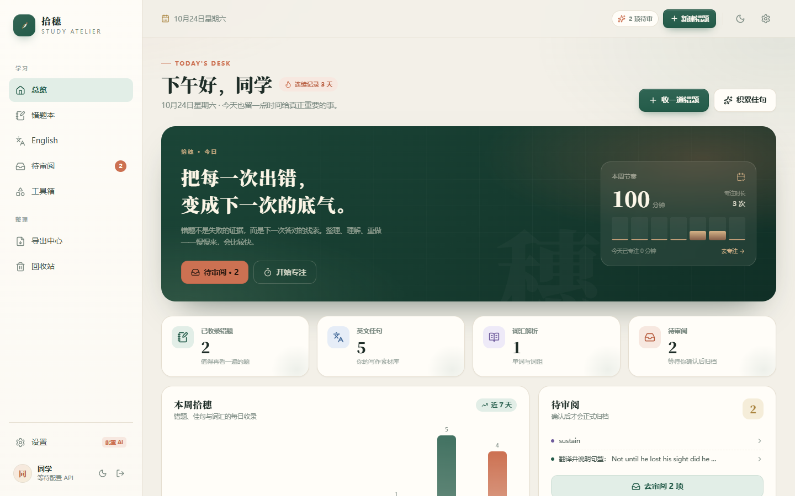
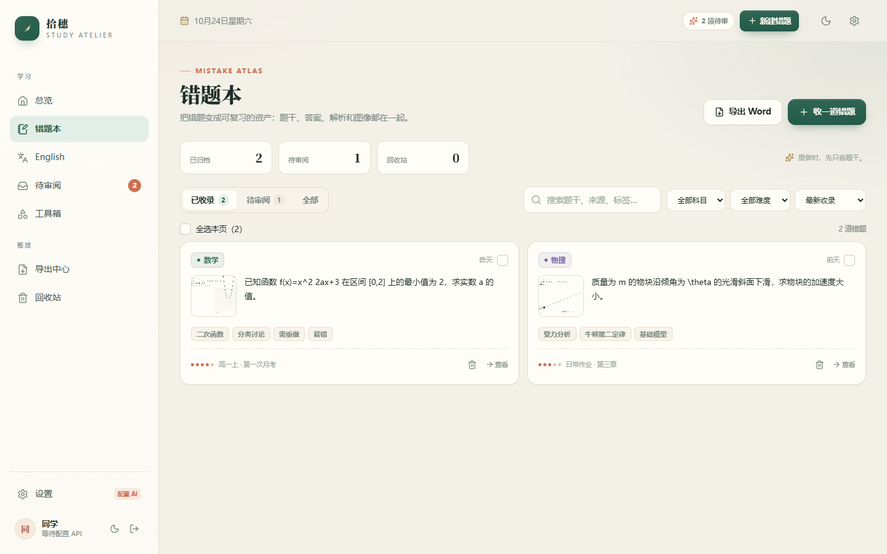
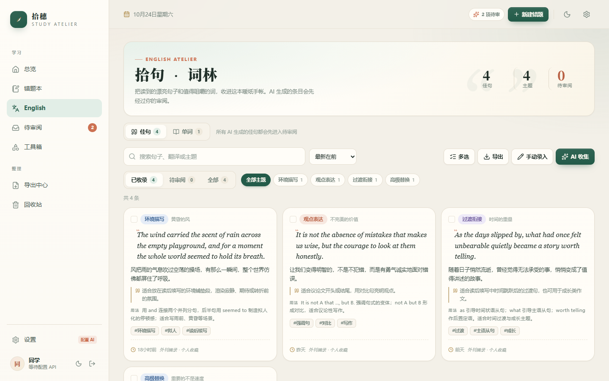
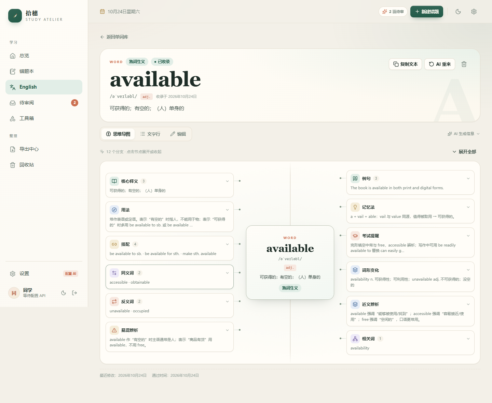
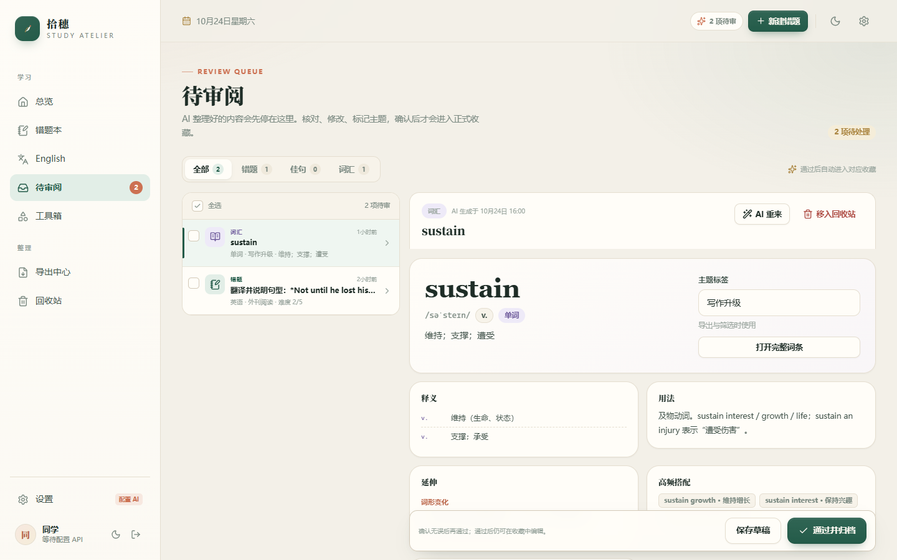
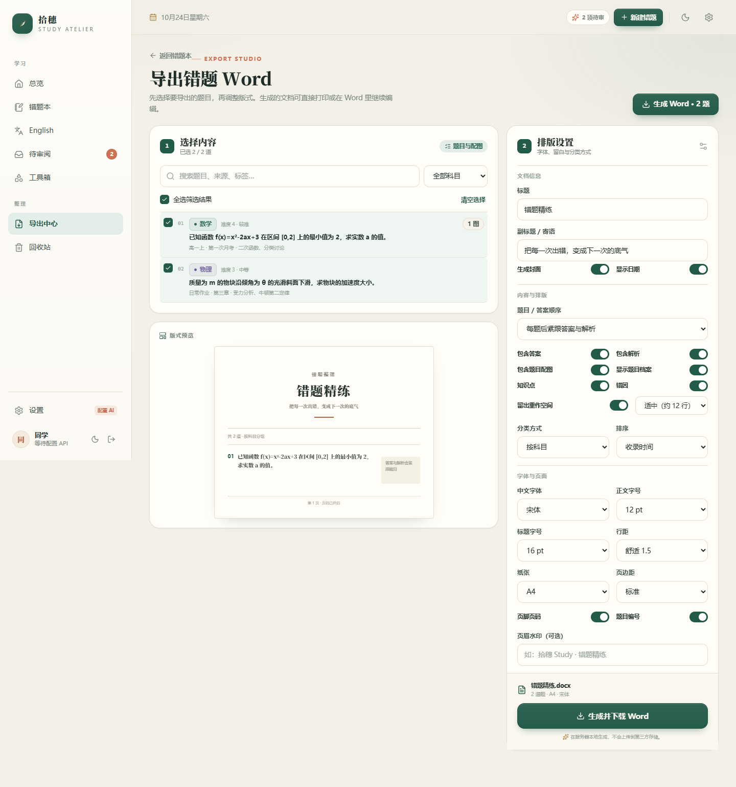
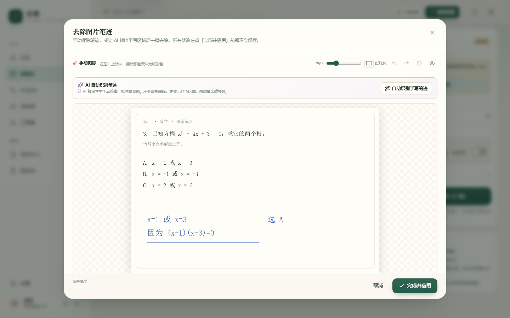

# 拾穗 Study · 高中学习工作台

一个为自己使用的、单用户的 **AI 学习工作台**。把错题、英文佳句、词汇和专注记录放在同一张书桌上；手机、平板、电脑访问同一个服务器，数据实时同步。

> 把每一次出错，变成下一次的底气。

  

## 界面预览

| 总览 | 错题本 |
| --- | --- |
|  |  |

| English 佳句 | 词汇思维导图 |
| --- | --- |
|  |  |

| 待审阅 | 错题 Word 导出 |
| --- | --- |
|  |  |

| 去除手写笔迹（彩色一键清除 + 智能修补 + AI 识别） |
| --- |
|  |

> 截图中的内容是通过 `npm run seed` 写入的示例数据，可在回收站中删除。

---

## 目录

- [功能一览](#功能一览)
- [5 分钟本地启动](#5-分钟本地启动)
- [Docker 部署](#docker-部署)
- [公网访问（多设备）](#公网访问多设备)
- [DeepSeek AI 配置](#deepseek-ai-配置)
- [使用流程](#使用流程)
- [Word 导出](#word-导出)
- [数据与备份](#数据与备份)
- [安全说明](#安全说明)
- [常见问题](#常见问题)
- [技术结构](#技术结构)
- [已知限制](#已知限制)

---

## 功能一览

### 1. 错题集（AI 视觉识别）

- 多张题目图片一起上传，AI 自动判断「多图一题」还是「一图多题」。
- 上传前逐张裁剪：可拖拽框选、调整、跳过；支持手机照片压缩。
- **去除手写笔迹**：每张题目原图都可以打开「去笔迹」工具。蓝/红/绿色笔迹可本地一键清除，不需要 API；铅笔字、整段批注可用「框选修补」：拖一个框，程序会从附近干净纸张取样并匹配光照，补出自然纹理；复杂纸纹可用「AI 蒙版」涂红后交给本机 LaMa 修补（需安装可选 AI 服务）。支持撤销/重做、对比原图，上传前与已收录错题的编辑页都可以使用。
- AI 提取题干、答案、解析、知识点、难度，公式使用 Markdown + LaTeX。
- AI 会根据题目判断是否需要画图，返回可直接绘制的函数表达式；审阅页与详情页会生成「AI 参考函数图像」，帮助你观察最值、交点与单调性。
- AI 标记题目中的函数图 / 几何图位置，审阅时一键裁剪成配图；也可从原图手动框选。
- 每题可切换「深度思考模式」（DeepSeek thinking），适合压轴题。
- AI 结果**不会直接入库**，先进入「待审阅」；可改、可补错因/来源/章节、可重来、可批量。
- 归档后支持按科目、难度、标签、来源筛选，回收站可恢复。

### 2. English

**佳句库**

- 三种收集方式：输入主题让 AI 原创、粘贴英文文本让 AI 提取、上传图片让 AI 识别。
- AI 生成：英文句子、中文翻译、用法/句型、新例句及翻译、内容概要、标签。
- 审阅时可单独标记 **主题**（用于分类导出）和 **内容概要**（句子讲什么／适合什么场景）。
- 可手动直接添加句子；可编辑、复制、AI 重来、批量通过、批量回收。
- Word 导出支持按主题分组、自定义主题顺序、自定义篇目顺序、卡片式/清单式。

**词汇解析**

- 输入单词或词组，AI 生成：音标、词性、核心释义、详细释义、用法、词形变化/近义辨析、高频搭配、同义/反义、易混、例句、记忆法、考试提醒。
- 可在「思维导图 / 文字行 / 编辑」三种视图间切换；思维导图节点可展开、可点击定位。
- 生成结果为待审阅；通过后进入词汇库，可继续编辑并同步到 Word 导出。

### 3. 待审阅 · 回收站 · 批量

- 所有 AI 任务的结果统一进入「待审阅」，错题、佳句、词汇可分别筛选。
- 审阅时可修改、补字段、让 AI 重来、单个通过、批量通过、移入回收站。
- 回收站支持恢复、永久删除、按类型筛选、一键清空；永久删除时会同时清理不再被任何题目引用的图片文件。
- 回收站支持**自动清理**：可设置保留 3–365 天，开启后服务器每 6 小时检查一次；也可随时「立即清理过期」，只删除已过期的内容。默认关闭，不会擅自删除数据。

### 4. Word 导出

- 错题：选择要导出的题目 → 封面/目录概览/答案位置/重作留白/配图/知识点/错因/分类/排序/字体/字号/行距/纸张/页边距/页码/水印。
- 英语：选择佳句 → 主题分组、主题顺序、篇目顺序、翻译/用法/例句/概要/标签/来源开关、卡片/清单布局、字体与页面。
- 下载前有版式预览；文档在服务器本地生成，不经过第三方存储。
- 公式在 Word 中会转成可读的 Unicode 近似（Word 不原生渲染 LaTeX）。

### 5. 小工具

- **番茄钟**：25/5/15 分钟预设、自定义时长、圆环进度、键盘空格控制、提示音、自动进入休息、专注统计。
- **高级计算器**：自研安全表达式解析器（不使用 `eval`），三角函数、对数、根号、阶乘、常量、DEG/RAD、内存、历史记录、键盘输入。
- **函数图像**：最多 4 条曲线、网格坐标、缩放平移、悬停追踪、不连续点断开、PNG 导出。

### 6. 账号与跨设备

- 单用户密码登录，HttpOnly Cookie，默认 30 天保持登录；登录限速。
- 数据保存在服务器 SQLite（单文件），图片保存在 `data/uploads`；设备之间天然同步。
- 支持修改密码、JSON 数据备份、Docker 数据卷。

---

## 5 分钟本地启动

### 环境要求

- **Node.js 24 或更高**（项目使用 Node 内置的 `node:sqlite`，无需安装数据库）
- npm 11+
- Windows / macOS / Linux 均可

### 步骤

```bash
# 1. 进入项目目录
cd study-atelier

# 2. 安装依赖
npm install

# 3. 可选：复制环境变量并设置管理员密码
copy .env.example .env      # Windows
# cp .env.example .env      # macOS / Linux
# 在 .env 中填写 ADMIN_PASSWORD；留空则首次启动自动生成随机密码

# 4. 开发模式（前端 5173，后端 8787，自动代理）
npm run dev
```

打开 **http://localhost:5173**。

- 如果没有设置 `ADMIN_PASSWORD`，首次启动会在 **服务器启动日志** 中生成并显示一次随机密码；请立即记录。
- 登录后立即到「设置 → 账号」修改密码。
- 想先看看界面？运行 `npm run seed` 会写入一组示例数据（仅在数据库为空时生效）。

### 生产模式（单机/局域网）

```bash
npm run build
npm start
```

打开 **http://localhost:8787**。手机连接同一 Wi-Fi 时，访问 `http://电脑局域网IP:8787`。

> 开发模式默认只监听 127.0.0.1；跨设备使用请用生产模式或 Docker。

### 自动启动（Windows 可选）

运行一次安装脚本后，Windows 会在**每次登录后自动在后台启动，并固定在 8787 端口**：

| 任务 | 作用 |
| --- | --- |
| `Shisui Study Server` | 登录时启动无窗口守护进程 |

- 安装：双击 `安装开机自启.bat`（或运行 `scripts\install-autostart.ps1`）。
- 计划任务通过 `wscript.exe` 调用隐藏启动器，不会每隔几分钟弹出 PowerShell 窗口。
- 服务进程崩溃后由守护脚本循环自动重启；端口固定为 `8787`。
- 停止：双击 `停止拾穗.bat`（或运行 `stop-study.ps1`）。本次登录期间不会自动重启，下次登录会恢复。
- 立即启动：双击 `启动拾穗.bat`（或运行 `start-study.ps1`）。
- 重新安装自启：双击 `安装开机自启.bat`；卸载：双击 `卸载开机自启.bat`。
- 日志：`logs/server.log`、`logs/stdout.log`、`logs/stderr.log`。
- 如果移动了项目目录，需要重新运行一次 `安装开机自启.bat`，计划任务里的路径才会更新。
- 该自启方式是当前用户登录后运行，不需要管理员权限；电脑重启后只要登录 Windows 就会恢复。

---

## Docker 部署

```bash
# 1. 准备环境变量
copy .env.example .env
# 修改 ADMIN_PASSWORD（首次启动的管理员密码）、JWT_SECRET（可留空自动生成）

# Linux 服务器：先创建数据目录，避免容器内 node 用户无写权限
# mkdir -p data && chown -R 1000:1000 data

# 2. 构建并启动
docker compose up -d --build

# 3. 查看状态
docker compose logs -f study
```

访问 **http://服务器IP:8787**。

- 数据库与图片持久化在 `./data` 目录。
- 更新代码后：`docker compose up -d --build`。
- 重置密码：

```bash
docker exec -it shisui-study node server/src/reset-password.js "你的新密码"
```

- 如果服务放在 Nginx / Caddy / Cloudflare Tunnel 后面，请设置 `TRUST_PROXY=1`，否则 `Secure` Cookie 与客户端 IP 可能识别不正确。

---

## 公网访问（多设备）

推荐 **Cloudflare Tunnel**：不需要公网 IP、不需要在路由器上开端口，自动 HTTPS，适合个人自托管。详细步骤见 [docs/DEPLOY.md](docs/DEPLOY.md)。

### 最短路径：临时 Tunnel

```bash
# 服务器上保持应用运行在 8787
cloudflared tunnel --url http://localhost:8787
```

终端会给出一个 `https://xxxx.trycloudflare.com` 地址，在手机/平板浏览器打开即可。临时地址重启后会变化。

### 长期使用：命名 Tunnel

1. 在 Cloudflare Zero Trust 创建 Tunnel，绑定域名（如 `study.example.com`）；
2. 把 Tunnel Token 写入 `.env` 的 `CLOUDFLARE_TUNNEL_TOKEN`；
3. 运行：

```bash
docker compose --profile tunnel up -d
```

或者把 Token 直接交给 `cloudflared` 服务。完整说明与 Caddy 方案见 [docs/DEPLOY.md](docs/DEPLOY.md)。

> **公开到公网前必须先确认管理员密码。** 登录接口已限速，但单用户项目没有注册与找回体系，密码就是唯一门锁。

---

## DeepSeek AI 配置

1. 打开 [DeepSeek 开放平台](https://platform.deepseek.com/) 创建 API Key。
2. 在本应用「设置 → AI 与提示词」填写 Key、Base URL、文本模型、视觉模型。
3. 点击「测试连接」→「保存设置」。

默认配置：

| 项 | 默认值 | 说明 |
| --- | --- | --- |
| Base URL | `https://api.deepseek.com` | OpenAI 兼容地址 |
| 文本模型 | `deepseek-flash` | 快、便宜，支持思考模式 |
| 视觉模型 | `deepseek-flash` | 原生多模态，题目图片识别 |
| 思考模式 | 每次任务可开关 | 通过 `thinking.type` 控制 |

- **Key 只保存在当前浏览器的 localStorage**，不会写入服务器数据库；调用 AI 时会由浏览器发给你自己的后端转发，后端不落盘、不记日志。
- 每台设备需要单独填写一次 Key。
- 可选的服务端兜底：在 `.env` 设置 `DEEPSEEK_API_KEY`，适合只想在一个受控设备上配置的场景；设置页会显示「已配置」，但不显示 Key 本身。
- 题目图片以 Base64 形式发送给 DeepSeek（与官方视觉接口一致），没有第三方中转。
- 视觉接口限制：JPEG/PNG/GIF/WebP、单图最大 32MB、请求体 48MB；本应用上传前会压缩，通常远低于限制。
- 官方文档：[图像理解](https://api-docs.deepseek.com/zh-cn/guides/vision) · [思考模式](https://api-docs.deepseek.com/zh-cn/guides/thinking_mode)

### 提示词

内置提示词在 `server/src/prompts.js`，针对高中错题、佳句、词汇做了结构化 JSON 约束。设置页可以给三类任务分别追加「额外要求」，无需改代码。

---

## 可选：本机 AI 修补（LaMa / IOPaint）

普通去笔迹、框选修补和彩色笔迹清除都不需要 Python。只有「AI 蒙版 → AI 修补」需要本机启动一个 LaMa Python 进程：

```powershell
python -m venv D:\ai\lama-venv
D:\ai\lama-venv\Scripts\python.exe -m pip install --no-cache-dir torch torchvision --index-url https://download.pytorch.org/whl/cpu
D:\ai\lama-venv\Scripts\python.exe -m pip install --no-cache-dir simple-lama-inpainting
```

然后把 `server/ai/config.example.json` 复制为 `server/data/ai/config.json`，填入你的 Python 路径。详细说明见 [server/ai/README.md](server/ai/README.md)。

- 首次使用会下载 `big-lama` 模型（约 200MB）到 PyTorch 缓存。
- CPU 处理一张 2000px 图片通常需要几十秒；不需要 GPU。
- 未安装时应用其他功能不受影响，只会隐藏/禁用「AI 修补」按钮。

---

## 使用流程

### 收一道错题

1. 「错题本 → 收一道错题」；
2. 上传 1–12 张题目图片，逐张裁剪掉无关内容（也可直接使用原图）；
3. 可选填科目提示、开启深度思考、写额外要求；
4. 点击「开始 AI 识别」，等待结果；
5. 自动跳转到「待审阅」：核对题干、答案、解析；补错因/来源/章节/知识点/难度；
6. 如果题目含函数图，在「题目配图」点「按 AI 标记裁剪」或「手动裁剪配图」；
7. 点击「通过并归档」，之后可在错题本查看或导出。

### 收集 English 佳句

1. 「English → 佳句 → 收集佳句」；
2. 选择「主题生成 / 文本提取 / 图片提取」，设置条数；
3. AI 生成后自动进入待审阅；
4. 在待审阅里为每条句子填写**主题**和**内容概要**，润色句子，可让 AI 重来；
5. 通过后进入佳句库，可搜索、按主题筛选、批量整理、导出 Word。

### 解析一个单词

1. 「English → 单词」输入单词或词组；
2. 生成后打开词条详情（待审阅状态）；
3. 在「思维导图 / 文字行 / 编辑」间切换，修改、补充；
4. 通过后成为正式词条，随时继续编辑。

### 导出

- 错题导出：错题本 → 导出 Word；或选中多题 → 导出所选。
- 佳句导出：English → 导出 Word。
- 导出前自定义内容与版式，点击「生成并下载 Word」。
- 详细选项见 [docs/EXPORT_OPTIONS.md](docs/EXPORT_OPTIONS.md)。

### 番茄钟 / 计算器 / 函数图像

在「工具箱」切换。番茄钟的专注记录会进入总览页的「本周节奏」和连续记录。

---

## Word 导出

- 错题支持「每题后跟答案」或「答案统一放卷末」，可留出重作空间；
- 支持按科目/来源/难度分组，A4/B5，标准/窄/宽边距，宋体/仿宋/楷体/雅黑/黑体；
- 配图会按页面宽度等比缩放并居中，带图注；
- 英语支持主题顺序和篇目顺序自定义，卡片式/清单式；
- 导出的 .docx 是标准 OOXML，可在 Microsoft Word、WPS、Pages 中打开继续编辑。

> LaTeX 公式在 Word 中会转成 Unicode 近似表达（如 `√`、`≤`、分数写为 `a/b`）。如果你需要原生 Word 公式，可在导出后手动替换重点公式。

---

## 数据与备份

| 内容 | 位置 |
| --- | --- |
| SQLite 数据库 | `data/study.db`（Docker 为 `/app/data/study.db`） |
| 图片文件 | `data/uploads/` |
| 密码 Hash / 会话密钥 | `data/app.json` |
| API Key | 浏览器 localStorage（不在服务器） |

- 设置页 → 数据 →「下载 JSON 备份」导出全部文字数据与图片索引。
- **完整备份**请复制整个 `data` 目录（或 Docker 数据卷）。
- 恢复：停止服务，用备份的 `data` 目录覆盖，启动。
- 修改密码：设置页，或 `npm run reset-password -- 新密码`。

---

## 安全说明

- 单用户系统，没有注册入口；密码是唯一门锁，请使用强密码并开启 HTTPS。
- 会话 Cookie：`HttpOnly` + `SameSite=Lax`；HTTPS 下自动 `Secure`。
- 登录接口 10 分钟最多 12 次尝试；写操作有同源校验。
- 上传文件仅允许图片、单张 20MB、最多 12 张；图片访问需要登录。
- 没有第三方分析脚本、广告或 CDN；前端所有资源随应用一起部署。
- API Key 保存在浏览器，需注意不要在公用电脑上保持登录。
- 公网部署前请阅读 [docs/DEPLOY.md](docs/DEPLOY.md) 的安全清单。

---

## 常见问题

**Q：登录后一直跳回登录页？**
确认浏览器允许 Cookie；如果通过反向代理访问，设置 `TRUST_PROXY=1`，并确保访问地址与 Cookie 域名一致。

**Q：AI 识别很慢 / 超时？**
深度思考模式或图片较多时会变慢。可关闭思考模式、减少图片、先裁剪大图。单次请求超时 4 分钟。

**Q：提示无法连接 AI 服务 / API Key 无效？**
到设置页点「测试连接」；检查 Base URL、Key 余额、网络能否访问 `api.deepseek.com`。

**Q：Word 里的公式不是原生公式？**
这是已知取舍：Word 公式需要 OMML，本项目将 LaTeX 转成可读文本以保持稳定。网页端/复习时仍使用 KaTeX 原生渲染。

**Q：如何让手机访问？**
同一 Wi-Fi 用生产模式访问电脑局域网 IP；外网用 Cloudflare Tunnel 或 VPS。

**Q：忘记密码？**
在服务器运行 `npm run reset-password -- 新密码`；Docker 见上文。不会丢失数据。

**Q：备份后换服务器怎么迁移？**
复制整个 `data` 目录到新服务器，重新以同样方式启动。API Key 需要在各设备重新填写一次。

---

## 技术结构

```
study-atelier/
├─ client/                  React 19 + Vite 前端
│  ├─ src/
│  │  ├─ components/       设计系统、表单、裁剪器、Word 导出配置界面等
│  │  ├─ contexts/         登录、Toast、主题
│  │  ├─ features/         English、工具箱
│  │  ├─ pages/            总览、错题、待审阅、设置、导出
│  │  └─ styles/           CSS 设计变量与页面样式
│  └─ vite.config.js
├─ server/                  Node.js + Express 后端
│  ├─ src/
│  │  ├─ db.js             SQLite schema、映射与 CRUD 辅助
│  │  ├─ ai-service.js     DeepSeek 调用、JSON 修复、视觉输入
│  │  ├─ prompts.js        三类任务的系统提示词
│  │  ├─ export/           Word 生成（docx）
│  │  └─ routes/           REST API
│  └─ data/                运行后生成：数据库、上传图片、app.json
├─ docs/                   部署与使用文档
├─ Dockerfile / docker-compose.yml
└─ package.json
```

- 前端：React 19、React Router 7、Vite 7、lucide-react、react-markdown + KaTeX
- 后端：Express 5、`node:sqlite`、multer、jsonwebtoken、bcryptjs、docx
- 无外部数据库、无 Redis、无云存储，一台机器即可完整运行。

### 测试

```bash
npm test
```

包含 API/数据层与 Word 导出测试。前端视觉与交互通过 Chrome 桌面/移动视口人工与自动化验收。

---

## 已知限制

- 单用户，不支持多账号或分享。
- Word 公式为 Unicode 近似，不是 Word 原生 OMML 公式。
- AI 输出可能有误；所有内容必须经过「待审阅」确认，这是产品设计的一部分。
- 「AI 参考函数图像」是根据 AI 返回的表达式即时绘制的辅助图，不是原题截图；遇到复杂定义域或渐近线时以数学推导为准。
- 图片最大 20MB/张，超过会拒绝；手机原图会在浏览器压缩到约 2200px。
- 函数图像支持常见初等函数组合，不是完整的计算机代数系统。
- 计算器与函数图像解析器为自研，极端表达式可能与专业工具存在差异。

---

## 许可

个人学习自用项目。第三方依赖遵循各自许可证。题目、笔记与 API Key 均归你所有。
